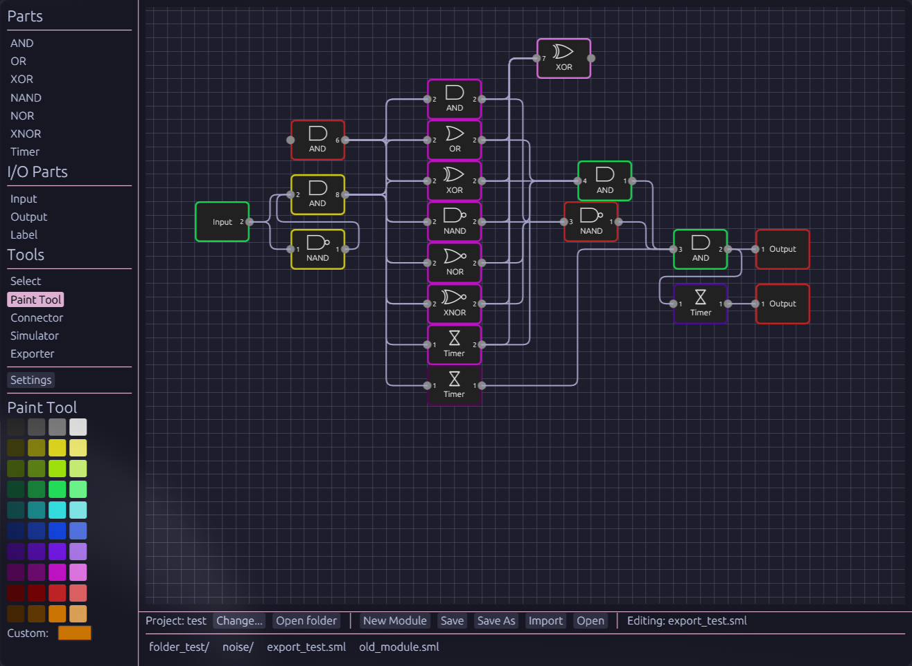

# SMLogic
A simple tool for designing complex Scrap Mechanic logic circuits :) 

Feel free to reach out on Discord with issues or suggestions! (I like talking to ppl :3) 

Also this program is just a single executable binary, making installation/uninstallation across OS/Distros easy.

This program shouldn't ever break from a Scrap Mechanic update, so even if I get busy and stop working on it that should be okay.

### images

https://github.com/user-attachments/assets/64101c28-d356-4076-ab3d-d7011c7c3c9f

## Some info

If you want to auto automate creating circuits or generating modules, there is basic LUA integration ([documention](github_resources/lua_scripting.md))

Modules are saved and loaded in the bottom bar, these modules can be exported to Scrap Mechanic with the export tool or imported into other modules by either selecting them like a part or importing them with the import button.

the connector tool is meant to help when you need to connect many things at once, it currently doesn't have many modes but im working on adding more, if you have ideas lmk!

The simulator runs in a single seperate thread from the main program. I tried hard to make it efficient, but if you unlimit the TPS the ui may lag a little bit. This simulator should match the game perfectly, and you can toggle gates on or off by clicking them.

With the export tool, it should find your Scrap Mechanic folder for you, but on first installation check to make sure it did in settings (it only finds the game on your main drive). If you enable `Keep IO Position`, it will orient Input/Output/Important parts on the output the same way as they are on the canvas (as opposed to only keeping color). You may also limit the size of the outputed block, so you can make flat sheets of logic or even just a 1x1x1 cube.

## Weird quirks
**This program is a little weird in various ways, so hopefully this clears some things up.**

Inputs and outputs of the main module that gets exported will become dedicated AND gates, however any sub modules there inputs are passed through. This means if you have `gate1` -> `module/input1` and inside `module` you have `input1` -> `gate2`, this is the equivalent of `gate1` -> `gate2`.

## Installation / Uninstallation
To install this program, you can either compile it from source, or if on (x86-64) Windows/Linux, just download one of the files in [releases](releases/)

As for uninstallation, just delete the binary executable you downloaded. \
The only residual files should be the main config file, located in the below paths
- Linux: `~/.config/smlogic/config.json`
- Windows: `%APPDATA%\smlogic\config.json`
- macOS: `~/Library/Application Support/smlogic/config.json`

note: macOS is not officially supported or tested, but it should work.

### NOT VIBE CODED SLOP !!
I made this project to learn Rust better as I am very new to it, the project ended up being more complex than I'd imagined however I only used AI/LLM's for debugging, helping answer questions I had, and very small code snippets. any functions that were AI generated I marked as such in the source code. I've found vibe coding to be one of the worst ways to learn a new language, plus nowhere near as fun, so I see no reason to vibe code this.
